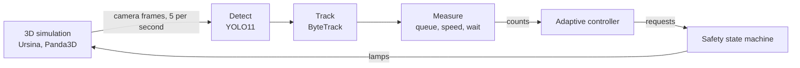

# SmartCross

A traffic light that sees the road. SmartCross simulates a four-way intersection in 3D, films it
with four roadside virtual cameras, counts the cars with computer vision, and uses those counts to
decide who goes next.

This is a learning project. Everything runs in simulation, and nothing here has been tested on a
real road.

## How it works



- **Vision is the only input.** The controller never reads a car count from the simulator. Ground
  truth is used only to label training data and to score results afterwards.
- **Detect, track, measure.** A YOLO11 model fine-tuned on frames from this simulator finds the
  vehicles. ByteTrack follows each one, so a car counts once rather than once per frame. Camera
  calibration turns pixels into metres for queue length, speed, waiting time and stop-line crossings.
- **Safety is separate from decisions.** The controller only makes requests. A state machine alone
  changes the lamps, always through yellow and all-red, and enforces a minimum green.
- **Failures are explicit.** A camera that stops sending usable frames is reported as unavailable,
  never as an empty road, and the lights run a fixed plan until it returns.
- **The controller can run as a separate program.** Over MQTT, the simulation holds for 5 seconds if
  messages stop, then falls back to its local fixed plan until they return.

## Results

Average time lost per car, in seconds, with camera input. Lower is better. Each figure is the mean of
5 seeds, each 1800 simulated seconds.

| Scenario | Fixed 20/20 timer | Fixed plan tuned for the scenario | SmartCross |
| --- | ---: | ---: | ---: |
| Normal traffic | 24.3 | 18.7 | **16.8** |
| Heavy overload | 86.6 | 72.5 | **71.7** |
| Uneven overload | 252.5 | 78.6 | **75.6** |

The gain over a tuned plan is small. The practical benefit is that SmartCross gets there without
anyone knowing the demand in advance.

### Known limits

- Results come from simulated traffic only, and no red-light runners are simulated.
- A camera that freezes on a normal-looking picture is not noticed.
- One dead camera costs about 29% more time lost, because the whole intersection uses the fixed plan.
- Worst-case waits rose in lighter traffic.

## Run it

You need Python 3.11 or newer. A GPU is strongly recommended: the live window runs a detector on four
cameras. The install downloads about 8 GB with the CUDA build of PyTorch.

```bash
git clone https://github.com/kreanimator/smartcross.git
cd smartcross
python3 -m venv .venv
source .venv/bin/activate
pip install -e ".[vision,messaging,dev]"
```

### 1. Train the detector

Model weights are not in this repository, so make your own once. This records the simulator, labels
the frames from ground truth, and fine-tunes YOLO11. The pretrained model downloads automatically.

```bash
for seed in 100 101 102 103 104 105 106 107 90 91; do
    python -m simulator.record --out runs/rec/seed$seed --seed $seed --start 30 --seconds 300 --fps 0.5
done

python -m vision.dataset --out runs/set \
    --train runs/rec/seed10{0..7} \
    --val runs/rec/seed90 runs/rec/seed91

python -m vision.train runs/set --name finetune
cp runs/finetune/weights/best.pt weights/smartcross_vehicle.pt
```

### 2. Open the live window

```bash
python -m simulator.world
```

Options: `--seed`, `--strategy` and `--weights`.

### 3. Run over MQTT (optional)

This needs Docker for the local broker. Use two terminals, and start the controller first.

```bash
docker compose up -d mosquitto
python -m messaging.run controller --simulation-id demo
python -m messaging.run simulation --simulation-id demo --seed 42 --seconds 600
```

### Tests and measurements

```bash
pytest
python -m evaluation.camera_control --weights weights/smartcross_vehicle.pt
python -m evaluation.camera_faults --weights weights/smartcross_vehicle.pt --dead north
```

## Project layout

| Folder | Contents |
| --- | --- |
| `simulator/` | Traffic, 3D scene, virtual cameras, live window and recording |
| `vision/` | Dataset, training, detection, tracking and the camera sensor |
| `controller/` | Traffic light state machine, fixed timer and adaptive control |
| `messaging/` | MQTT bus, message schemas and the two-program setup |
| `evaluation/` | Metrics and comparison tools, which alone may use ground truth |
| `assets/` | Kenney 3D models (CC0) |
| `tests/` | Test suite |

## Built with

Python, Ursina, Panda3D, Ultralytics YOLO11, ByteTrack, OpenCV, PyTorch, MQTT (Eclipse Mosquitto,
paho-mqtt), and 3D models by Kenney.

## License

SmartCross's own work is dedicated to the public domain under CC0 1.0. Third-party components keep
their own licenses. Ultralytics is AGPL-3.0, which applies if you distribute SmartCross together with
it or offer it as a network service. See [LICENSE](LICENSE) for the full list and the rights used.
